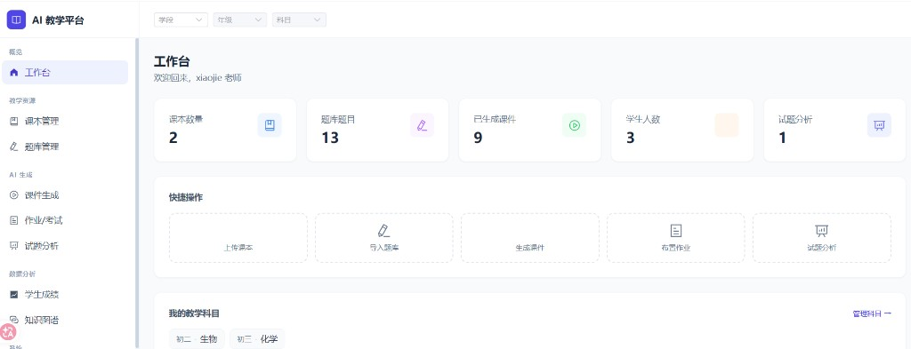
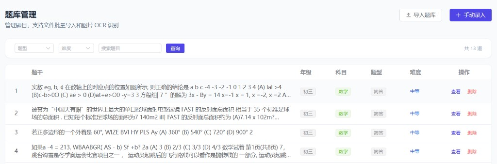
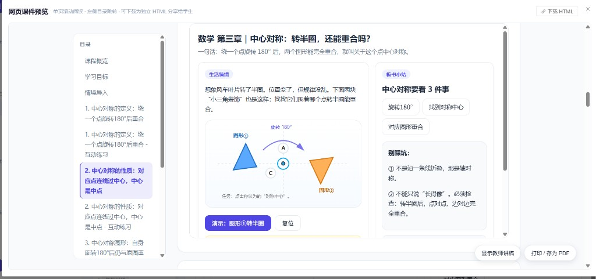
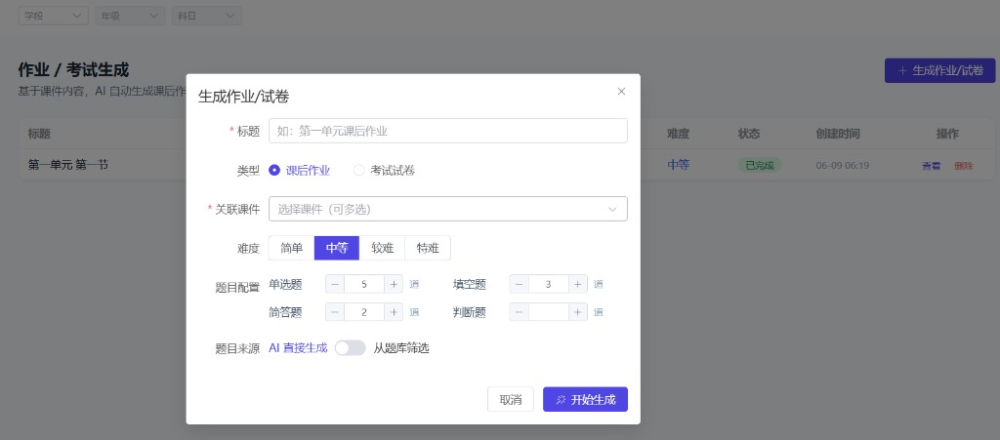
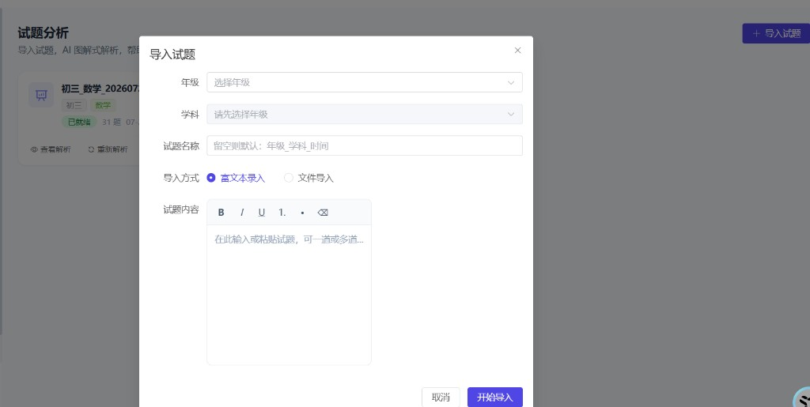
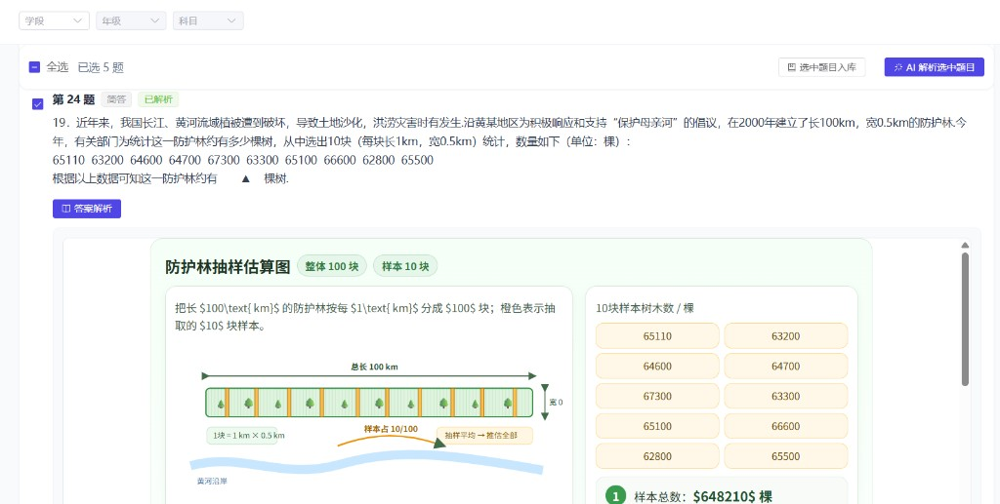
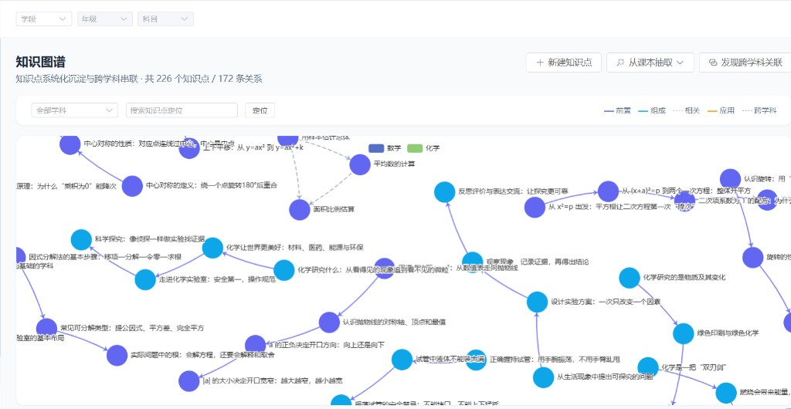
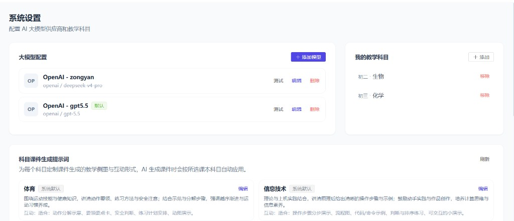

# 智课星

面向教师的 Web 应用：用 AI 辅助备课、出题、阅卷分析和知识图谱。上传课本后即可生成课件 / 作业，试题可做图解式解析，成绩与知识点沉淀在同一套工作流里。

理科互动课件页引用了开源项目 [edulab](https://github.com/wy51ai/edulab)（Apache-2.0）的三个 skill：立体几何、解析几何、化学反应。LLM 只负责判断题型，数值与整页 HTML 由 sympy + 模板确定性生成，避免模型直接写互动页导致空白、转义或答案对不上。

| 前端 | 后端 | 任务队列 | 存储 |
|---|---|---|---|
| Vue 3 + TypeScript + Vite + Pinia + Element Plus | FastAPI + SQLAlchemy 2.0（异步） | Celery + RabbitMQ | MySQL / Redis / MinIO / Neo4j / Qdrant |

默认入口：

- 教师端：<http://localhost:3000>
- API 文档：<http://localhost:8000/docs>
- 课堂互动（学生免登录）：`/s/:token`

---

## 目录

- [功能一览](#功能一览)
- [理科互动 Skill（edulab）](#理科互动-skilledulab)
- [如何使用](#如何使用)
- [注册开关 ENABLE_REGIST](#注册开关-enable_regist)
- [本地开发启动](#本地开发启动)
- [Docker 一键启动](#docker-一键启动)
- [部署说明](#部署说明)
- [端口与默认账号](#端口与默认账号)
- [常见问题](#常见问题)

---

## 功能一览

顶栏可按 **学段 / 年级 / 科目** 筛选，多数列表页都会跟着这个全局上下文走。

### 工作台

登录后的总览：课本、题库、课件、学生、试题分析的数量，以及跳转到各模块的快捷入口。授课科目可在设置里维护。



### 课本管理

上传 PDF / Word / TXT / EPUB / MOBI（单文件 ≤ 500MB）。后台异步解析章节、页码和插图，解析完成后可供课件生成引用。支持预览、查看章节树、重新解析。

**电子课本从哪来：** 本平台不托管国家课程 PDF。若需要从 [国家中小学智慧教育平台](https://basic.smartedu.cn/) 取得电子课本，可使用开源工具 [tchMaterial-parser](https://github.com/happycola233/tchMaterial-parser)（MIT）：粘贴课本预览页网址，批量解析下载 PDF，并可自动按书名命名、添加书签。下载到本地后，再在智课星里「上传课本」走后续解析与课件生成。

使用方法、Access Token、免责声明见该项目文档。资源版权归原平台及相关权利人所有，请仅用于个人学习与教学参考，勿用于商业用途或二次分发；该工具与国家中小学智慧教育平台无隶属或合作关系。


### 题库管理

维护题目：文件批量导入、图片 OCR、手动录入。可按题型、难度、关键词筛选，查看或删除。



### 课件生成

基于关联课本（章节或页码范围）由 AI 生成课件。创建时可选择：

- **呈现样式**：PPT（课堂翻页演示，可导出 PPT / Word / PDF）或网页（单页滚动，可下载 HTML）
- **视觉主题**：靛蓝学院、清新绿意、活力暖橙、温暖珊瑚、晴空蓝、极简墨黑（在线预览与导出共用）
- **课件类型**：标准 / 互动（数学 / 化学 / 生物命中题型时走 [edulab](https://github.com/wy51ai/edulab) skill，失败再回退 LLM）
- **教师想法**：自定义侧重点、难度与互动形式

详情页支持演示模式、网页预览、课堂互动会话（生成分享链接给学生）、导出。网页样式为单页滚动阅读：左侧目录跳转，可下载独立 HTML 分享给学生，也可打印 / 存为 PDF。




### 作业 / 考试

关联已生成的课件，配置题型数量与难度，由 AI 出卷或从题库筛选。支持课后作业与考试试卷两种类型，完成后可查看、导出。



### 试题分析

导入一套卷（富文本粘贴或文件），异步拆题后可对选中题目做 **AI 图解式解析**（含示意图与公式），解析结果可回存题库。





### 学生成绩

成绩录入（手动 / 文件导入）、按科目·考试汇总（最高/最低/平均、高分线与低分线可调）、统计分析，以及 AI 学情报告。


### 知识图谱

知识点存在 Neo4j，关系类型含前置、组成、相关、应用、跨学科。可手动新建、从课本抽取，或发现跨学科关联；Qdrant 用于语义去重（未配置嵌入模型时退化为按名称匹配）。



### 系统设置

配置大模型供应商（OpenAI 兼容网关、通义、DeepSeek、智谱、Ollama 等，走 LiteLLM）、设默认模型、测试连通；管理「我的教学科目」；按科目覆盖课件生成提示词。



> API Key 加密存库，不要写进 `.env` 再提交。

---

## 理科互动 Skill（edulab）

互动课件里的理科演示页来自 [wy51ai/edulab](https://github.com/wy51ai/edulab/tree/master)（Apache-2.0，作者 WY · [@akokoi1](https://github.com/wy51ai)）。源项目把一道题做成**自包含交互网页**（3D / 画板 + 分步解析）；本仓库把其中三个 skill 放到 `backend/skills/`，在生成**互动课件**时调用。

| 本仓库目录 | 源 skill | 学科 | 产出 |
|---|---|---|---|
| `backend/skills/edu-solid-geometry` | [edu-solid-geometry](https://github.com/wy51ai/edulab/tree/master/skills/edu-solid-geometry) | 数学 | 立体几何：Three.js 3D + MathJax 分步（线面角、二面角、异面直线、点面距、体积等） |
| `backend/skills/edu-analytic-geometry` | [edu-analytic-geometry](https://github.com/wy51ai/edulab/tree/master/skills/edu-analytic-geometry) | 数学 | 圆锥曲线：Canvas 画板 + KaTeX（数量积范围、弦长、面积最值、定值、离心率等） |
| `backend/skills/edu-chem-reaction` | [edu-chem-reaction](https://github.com/wy51ai/edulab/tree/master/skills/edu-chem-reaction) | 化学 / 生物 | 反应微观演示：Three.js 分子动画 + 配平方程（燃烧、电解水、氧化还原、酯化、葡萄糖氧化等） |

**在本项目中怎么工作：**

1. 教师创建 **互动课件**，生成流程走到互动页时，先由 LLM **只判类别**（是否立体几何 / 解析几何 / 化学反应，以及哪一种题型）。
2. 命中后，后端用子进程调用对应的 runner（数学）或 skill 自带的 `scripts/generate.py`（化学）。**坐标、答案、步骤数值全部由 sympy 内核算出**，再注入数据驱动模板，得到整页 HTML。
3. 前端仍用原来的 iframe 展示，无需为 skill 单独改页面。
4. 未命中、子进程失败或超时 → 返回空串，上层回退成原来的 LLM 写 HTML，不影响其它科目。

### 概念课也能出 3D / 画板

上述题型都对应一道具体的题。数学还有两个**通用探究题型**，专门覆盖「认识棱柱棱锥」「椭圆的定义」这类没有题面的概念课——同样是确定性生成，不是让 LLM 现写 HTML：

| 题型 | 形态 | 支持的对象 | 讲什么 |
|---|---|---|---|
| `solid_explore` | 可旋转 3D 教具 | 正方体、长方体、正四棱锥、正四面体、正三棱柱 | 顶点/棱/面计数、棱长标注、高亮底面与高，sympy 精确推体积与表面积 |
| `curve_explore` | 可拖动画板 | 椭圆、双曲线、抛物线、圆 | 焦点/顶点/准线/渐近线/切线，拖动动点实时显示焦半径，用定值指示器演示第一定义 |

`curve_explore` 的定值演示是这两个题型的重点：拖动滑块时 $|PF_1|$、$|PF_2|$ 各自在变，而它们的和（椭圆）、差的绝对值（双曲线）、到焦点与到准线之差（抛物线）在控制台里纹丝不动，定义就在画面上自己成立了。

接入代码在 `backend/app/services/skill_service.py`，能力表见 `SKILL_CAPABILITIES`；两个数学 skill 的 spec 构造在 `backend/app/services/skill_runners/`。三个 skill 的模块名会冲突，所以用子进程隔离，改其中一个时不要顺手打开另外两个。

计算依赖 **sympy**（已在 `backend/requirements.txt`）。化学 skill 的 RDKit 是可选的：没装就用内置 VSEPR 分子库，**不会自动安装 RDKit**。

独立验证（在对应 skill 目录下，与上游用法相同）：

```bash
cd backend/skills/edu-solid-geometry
python3 scripts/generate.py cube ./cube.html

cd backend/skills/edu-analytic-geometry
python3 scripts/generate.py ellipse_dot_range ./sol.html

cd backend/skills/edu-chem-reaction
python3 scripts/generate.py combustion_ch4 ./reaction.html
```

通用探究题型带参数，用接入层的 runner 验证（在 `backend/` 下执行，生成的 HTML 直接用浏览器打开）：

```bash
python3 app/services/skill_runners/solid_geometry_runner.py \
  '{"problem_type":"solid_explore","body":"quad_pyramid","base_edge":4,"height":3}' /tmp/solid.html

python3 app/services/skill_runners/analytic_geometry_runner.py \
  '{"problem_type":"curve_explore","curve":"ellipse","a":2,"b":1}' /tmp/curve.html
```

源项目也可用 `npx skills add wy51ai/edulab` 装到 Claude Code 等环境；本平台不走这条路径，而是在课件生成管线里直接调本地副本。上游说明见 [edulab README](https://github.com/wy51ai/edulab/blob/master/README.zh-CN.md)。

---

## 如何使用

1. 按下文启动服务，浏览器打开 <http://localhost:3000>。
2. **登录**。默认开放注册，登录页有「立即注册」。上线后若要关掉自助注册，见 [注册开关 ENABLE_REGIST](#注册开关-enable_regist)。

3. 进入 **系统设置**，添加至少一个大模型并设为默认，点「测试」确认可用。课件、作业、试题分析、知识抽取都依赖这一步。
4. 在设置里添加 **我的教学科目**，顶栏选中对应学段 / 年级 / 科目。
5. 推荐路径：**准备课本 PDF（可用 [tchMaterial-parser](https://github.com/happycola233/tchMaterial-parser) 从智慧教育平台下载）→ 上传课本 → 等解析完成 → 生成课件 / 作业**；试卷分析、成绩、知识图谱可按需使用。
6. 课件详情里开启 **课堂互动** 后，把 `/s/:token` 链接发给学生即可，学生端无需登录。

课本解析、课件生成等耗时任务走 Celery，页面状态为「处理中」时请确认 `celery_worker` 在跑。

---

## 注册开关 ENABLE_REGIST

环境变量 `ENABLE_REGIST` 控制登录页是否显示「立即注册」，并同步开关后端 `POST /api/v1/auth/register`（关掉后接口返回 403，不能只藏按钮）。登录页通过公开接口 `GET /api/v1/auth/config` 读取 `{ "enable_regist": true/false }`，因此 **改变量后只需重启 backend，不必重建前端镜像**。

| 值 | 效果 |
|---|---|
| 不设、`true`、`1`、`yes` | 显示注册入口，允许注册（**默认**） |
| `false`、`0`、`no` | 隐藏入口，拒绝注册，仅已有教师账号可登录 |

**本地开发**（`backend/.env`）：

```bash
ENABLE_REGIST=true
# ENABLE_REGIST=false
```

**Docker Compose**（`docker-compose.yml` 里 `backend.environment`，已默认 `"true"`）：

```yaml
backend:
  environment:
    ENABLE_REGIST: "true"    # 生产可改为 "false"
```

改完后：

```bash
docker compose up -d backend
```

生产建议：先用默认打开注册建好教师账号，再把 `ENABLE_REGIST` 设为 `false` 并重启 backend，避免公网随意注册。

---

## 本地开发启动

适合改前端 / 后端代码。中间件用 Docker，应用在宿主机跑。

### 环境要求

- Python 3.11、Node.js 20+
- Docker（只起 MySQL / Redis / RabbitMQ / MinIO / Neo4j / Qdrant）

### 1. 基础设施

```bash
cd /path/to/edu_project
docker compose up -d mysql redis rabbitmq minio neo4j qdrant
```

连接信息与 `backend/.env` 默认值一致（主机名用 `localhost`）。

### 2. 后端

```bash
cd backend
python -m venv .venv
source .venv/bin/activate          # Windows: .venv\Scripts\activate
pip install -r requirements.txt
uvicorn app.main:app --reload --host 0.0.0.0 --port 8000
```

另开终端跑 Worker（生成 / 解析必需）：

```bash
cd backend
source .venv/bin/activate
celery -A app.tasks.celery_app worker --loglevel=info -Q ai_tasks,file_tasks
```

启动时会 `create_all` 建表、补列，并写入学段 / 年级 / 科目种子数据，无需手跑 Alembic（`alembic/versions/` 目前为空）。

### 3. 前端

```bash
cd frontend
npm install
npm run dev
```

Vite 在 `:3000`，`/api` 与 WebSocket 代理到 `:8000`。

---

## Docker 一键启动

会同时构建并启动前端（nginx 静态包）、后端、Celery 和全部中间件。本机端口 **3000 / 8000 / 3306 / 6379 / 5672 / 15672 / 9000 / 9001 / 7474 / 7687 / 6333 / 6334** 需空闲；建议可用内存 ≥ 8GB（Neo4j 单独约占 1.5GB）。

```bash
cd /path/to/edu_project
docker compose up -d --build
```

第一次构建较久（后端镜像含 Tesseract OCR，前端会执行 `vue-tsc && vite build`）。看状态：

```bash
docker compose ps
docker compose logs -f backend celery_worker
```

MySQL / Neo4j 尚未就绪时，后端可能重启一两次，属正常。日志出现 Uvicorn 监听 `8000` 后访问 <http://localhost:3000>。默认开放教师注册；关闭方式见 [ENABLE_REGIST](#注册开关-enable_regist)。

compose 里的前端是生产构建，改 Vue 代码不会热更新。日常开发请用上一节「本地开发启动」。

停止：

```bash
docker compose down          # 保留数据卷
docker compose down -v       # 删除 MySQL / MinIO / Neo4j 等全部数据
```

---

## 部署说明

面向一台服务器的最小部署可直接用仓库根目录的 `docker-compose.yml`：

| 服务 | 说明 |
|---|---|
| `frontend` | `npm run build` 后由 nginx 托管，`/api` 反代到 `backend:8000` |
| `backend` | `uvicorn app.main:app --host 0.0.0.0 --port 8000`（compose 里开了 `--reload` 并挂载源码，生产建议去掉 reload、改为复制进镜像） |
| `celery_worker` | 消费 `ai_tasks`、`file_tasks` |
| `mysql` / `redis` / `rabbitmq` / `minio` / `neo4j` / `qdrant` | 业务库、缓存、队列、对象存储、图谱、向量 |

机器相关项（如浏览器访问 MinIO 的地址）写在仓库根目录 `.env`，不要改 `docker-compose.yml`。复制 `.env.example` 为 `.env` 后按本机填写；该文件已被 gitignore。

```bash
cp .env.example .env
# 编辑 MINIO_PUBLIC_ENDPOINT=公网IP:9000
docker compose up -d backend celery_worker
```

上线前建议：

1. 修改 `SECRET_KEY`、`ENCRYPTION_KEY`，以及 MySQL / MinIO / RabbitMQ / Neo4j 密码（同时改 compose 的 `environment`）。
2. 将 `ENABLE_REGIST` 设为 `false`，禁止公网自助注册（见 [注册开关](#注册开关-enable_regist)）。
3. 后端、Celery **不要**把宿主机 `backend/.env` 的 `localhost` 带进容器；compose 已用服务名（`mysql`、`redis` 等）注入。根目录 `.env` 做 compose 变量插值（MinIO 公网地址、嵌入模型 Key 等），不要把密钥写进已跟踪的 `backend/.env`。
4. 用反向代理终结 HTTPS，把 443 转到 `frontend:80`；WebSocket 路径 `/api/v1/ws/task/{task_id}` 需要升级头。
5. 生产关闭后端 `--reload`，前端构建参数用生产 API 源（当前 nginx 已走容器网络 `backend:8000`）。
6. 数据卷定期备份：`mysql_data`、`minio_data`、`neo4j_data`、`qdrant_data`。

知识图谱向量去重可选：在**仓库根目录** `.env` 配置 `EMBEDDING_MODEL` / `EMBEDDING_API_BASE` / `EMBEDDING_API_KEY`（该文件已 gitignore）；留空则只按名称精确匹配。Docker 下由 compose 注入到 backend / Celery。

---

## 端口与默认账号

| 地址 | 用途 | 默认凭据 |
|---|---|---|
| http://localhost:3000 | 教师端 | 自行注册的教师账号（`ENABLE_REGIST=true` 时） |
| http://localhost:8000/docs | Swagger | Bearer Token（登录后获取） |
| http://localhost:15672 | RabbitMQ 管理台 | `edu_user` / `edu_pass` |
| http://localhost:9001 | MinIO 控制台 | `edu_minio_user` / `edu_minio_pass` |
| http://localhost:7474 | Neo4j Browser | `neo4j` / `edu_neo4j_pass` |

MySQL：库 `edu_platform`，用户 `edu_user` / `edu_pass`（root：`edu_root_pass`）。以上均为开发默认值，不要用于公网。

---

## 常见问题

**登录页没有「立即注册」**  
检查 backend 环境变量 `ENABLE_REGIST` 是否为 `false`。登录页读的是 `GET /api/v1/auth/config`，改完需重启 backend，不用重建前端。

**课件 / 课本一直「生成中 / 解析中」**  
检查 `celery_worker` 是否在跑，RabbitMQ 是否健康。

**能登录但 AI 功能失败**  
到系统设置添加模型、设为默认并测试。未配置 LLM 时生成任务会失败。

**`docker compose build` 前端失败（vue-tsc）**  
前端 `npm run build` 会先类型检查。HTTP 客户端在 `frontend/src/api/index.ts`，拦截器已解包 `res.data`。

**端口被占用**  
改 `docker-compose.yml` 左侧宿主机端口，或先停本机对应服务。

**知识图谱抽不到跨学科相似点**  
未配嵌入模型时不会做向量去重/发现，只按名称匹配。

**互动课件没有 3D / 画板，只有普通讲解**
skill 只在「互动课件 + 数学/化学/生物 + 题型命中」时介入。数学的多面体与圆锥曲线知识点即使没有具体题面，也会走 `solid_explore` / `curve_explore` 出 3D 或画板；但概率、数列、三角恒等变换、圆柱圆锥球等仍不在覆盖范围，会回退成 LLM 写的 HTML。可看 Celery 日志里有没有「命中 skill」这行，以及 skill 子进程是否报错。

---

## 致谢

- 理科互动页 skill 来自 [edulab](https://github.com/wy51ai/edulab)，协议 [Apache-2.0](https://github.com/wy51ai/edulab/blob/master/LICENSE)。在此致谢原作者。本仓库对 skill 的改动仅限于接入课件生成管线（子进程调用、题型路由、失败回退），内核与模板保持与上游一致。
- 电子课本下载可参考 [tchMaterial-parser](https://github.com/happycola233/tchMaterial-parser)（MIT）：国家中小学智慧教育平台电子课本解析与批量下载。智课星本身不内置该工具，下载后的 PDF 再上传到本平台解析。
